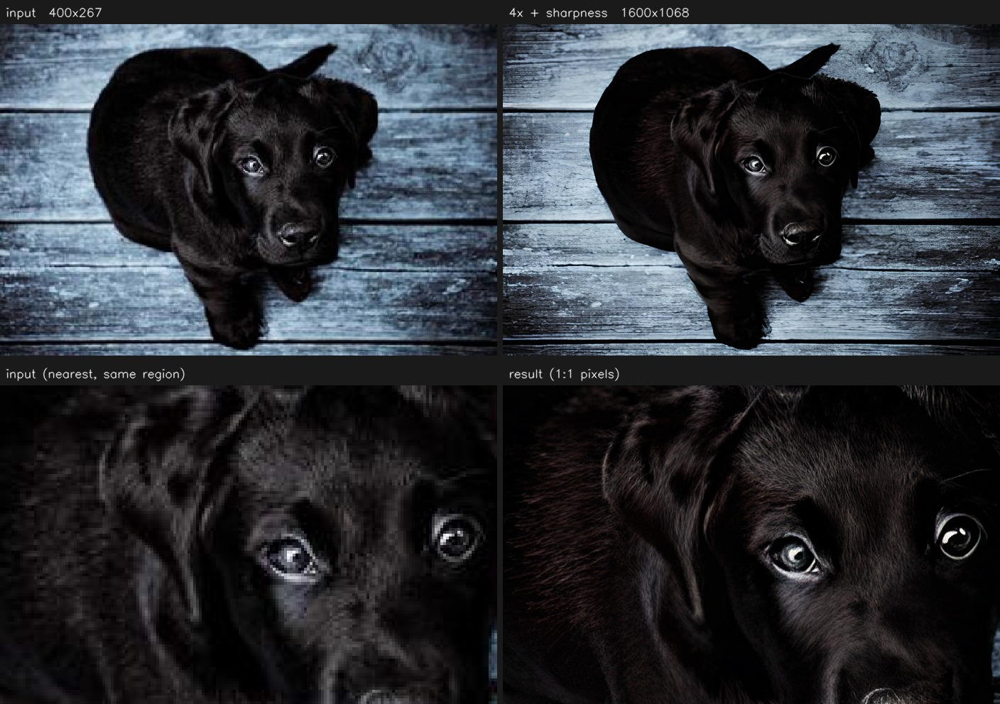

# PhotoVideoAI-SR

**语言 / Language**：**中文** · [English](README_EN.md)

[](LICENSE)
[](https://www.python.org/)
[](https://developer.nvidia.com/cuda-toolkit)

**本地运行的图片 / 视频 AI 超分工具**：Python + Gradio WebUI，NVIDIA CUDA 推理，
FFmpeg 负责媒体编解码。老照片修复、低分辨率视频放大、批量处理，全部在你自己的机器上完成，
不上传任何文件。

* 图片超分：RealESRGAN（支持加载自定义 LoRA 权重）
* 视频超分：RealESRGAN 逐帧链路（可微调）/ NVIDIA Maxine VSR 时序链路（可选组件，闭源）
* 批量图片、预览模式、自动下载模型、任务信息面板、输出格式可选
* 协议：MIT

> 本项目仅支持 **NVIDIA CUDA** 推理。代码与文档中不写死任何显卡型号，GPU 信息一律运行时探测。

**仓库地址**：[https://github.com/zjwan461/PhotoVideoAI-SR](https://github.com/zjwan461/PhotoVideoAI-SR)
· **问题反馈**：[Issues](https://github.com/zjwan461/PhotoVideoAI-SR/issues)

---

## 目录

- [功能特性](#功能特性)
- [目录结构](#目录结构)
- [硬件与软件前置](#硬件与软件前置)
- [安装](#安装)
- [模型下载](#模型下载)
- [快速启动](#快速启动)
- [使用说明](#使用说明)
- [参数说明](#参数说明)
- [模型对比：RealESRGAN vs Maxine](#模型对比realesrgan-vs-maxine)
- [LoRA：自定义模型风格](#lora自定义模型风格)
- [环境变量](#环境变量)
- [已知限制](#已知限制)
- [常见问题](#常见问题)
- [开发与自检](#开发与自检)
- [开源协议与致谢](#开源协议与致谢)

---

## 功能特性

| 分类 | 能力 |
| --- | --- |
| 📷 照片超分 | 单图超分；结果自动缩放到 720p / 1080p / 2K / 4K / 8K 或保持原始比例（**只做一次重采样**，缩小用面积平均）；**清晰度增强（CAS）**；**1:1 像素对比图**；PNG / JPG 输出 |
| 📁 批量处理 | 一次上传多张图片，或指定服务器上的文件夹，结果统一写入 `output/batch/`，带成功/失败汇总 |
| 🎬 视频超分 | RealESRGAN 逐帧链路；**管道式处理**（解码 → 推理 → 编码全程流式，不落中间帧）；提取并回填音轨；MP4 / MKV 输出；可覆盖输出帧率 |
| ⚡ 预览模式 | 只渲染前 N 帧（默认 30 帧）即可预览效果，不必等整片跑完 |
| 🧩 LoRA 加载 | 下拉选择 `lora_weights/` 中的权重，注入到卷积层，随时切换或卸载；不选则完全走原生基础模型 |
| 🧪 LoRA 微调 | 独立「模型微调」Tab：自动退化生成 LR、只训练 LoRA 参数、训练中出验证预览图 + PSNR、断点续训、只导出 LoRA |
| 🧹 附加增强 | 老照片可选**前置复原（SwinIR 去压缩块/去噪）**、去噪 / 轻量去划痕（传统算法，无需额外权重）、**清晰度增强（CAS）**；一键「老照片模式」；人脸修复 (GFPGAN) 与黑白上色为可插拔可选组件 |
| 🖥️ 硬件编码 | 合成视频优先使用 `h264_nvenc`，不可用时自动回退 `libx264` |
| 🩺 状态面板 | 运行时展示环境摘要、编码器可用性、可选组件状态、LoRA 列表 |
| 🛡️ 健壮性 | 显存预判与友好提示、FFmpeg 缺失提示、单帧失败降级、临时文件自动清理、输入文件只读 |
| ⏹ 任务取消 | 图片 / 批量 / 视频任务运行中随时可取消，通常 1 秒内停下并清理临时文件（模型下载阶段也能取消） |
| 🧹 显存管理 | 一键卸载已加载的模型并回收 CUDA 缓存，OOM 后不必重启程序（有任务在跑时会拒绝执行） |

### 效果示例



> 400×267 的网络照片 → **4× 超分 + 清晰度增强 0.35**（1600×1068，在 RTX 4080 SUPER 上约 0.7 秒）。
> 上排是整图对比；下排取同一区域做 **1:1 像素对比**（左侧为最近邻放大的原图，像素块清晰可见）。
> 毛发与木纹的细节是模型重建出来的，属于「合理生成」而非还原。
>
> 示例照片：[André Spieker](https://unsplash.com/photos/8wTPqxlnKM4) / Unsplash（Unsplash License）。

---

## 目录结构

```
PhotoVideoAI-SR/
├── app.py                          # Gradio WebUI 主入口
├── config.py                       # 全局配置、路径、预设、GPU 探测
├── requirements.txt                # 依赖（区分核心 / 可选 / 开发）
├── README.md  CONTRIBUTING.md  LICENSE  .gitignore
├── src/
│   ├── common.py                   # CUDA/显存检测、预判、清理、LoRA 扫描、日志
│   ├── ffmpeg_utils.py             # FFmpeg/FFprobe 封装：拆帧、提音频、合成、探测
│   ├── img_sr.py                   # RealESRGAN 图片超分（含 LoRA 注入接口）
│   ├── lora_runtime.py             # 卷积 LoRA 注入/加载/保存（手写实现，不依赖 peft）
│   ├── torchvision_compat.py       # 兼容垫片：修 basicsr 在新版 torchvision 下的导入失败
│   ├── video_sr_realesrgan.py      # RealESRGAN 逐帧视频推理
│   ├── video_sr_maxine.py          # Maxine VSR 时序视频推理（可选，自动 disable）
│   ├── enhance_extras.py           # 附加增强：去噪、轻量去划痕、清晰度增强、可插拔上色
│   ├── restore.py                  # 可选前置复原（SwinIR，同尺寸）：老照片去压缩块/去噪
│   └── train/                      # 【可选高级模块】LoRA 微调，独立目录
│       ├── lora_network.py         # 手写 LoRA 卷积层 / 只训练 LoRA / 权重合并
│       ├── lora_utils.py           # 注入、只导出 LoRA、推理时加载/卸载
│       ├── dataset.py              # HR 读取、增强、自动退化生成 LR、坏图过滤
│       ├── validator.py            # 训练中验证：三联预览图 + PSNR
│       └── trainer.py              # 训练循环、AMP、断点续训、后台运行器
├── tests/
│   ├── selftest.py                 # 基础自测（无 GPU 也能跑媒体链路部分）
│   ├── selftest_train.py           # 微调自测（合成数据 + 微型网络，CPU 可跑）
│   └── selftest_e2e.py             # 端到端真机验收（需 CUDA + 权重；图片/视频/LoRA/微调/UI）
├── scripts/
│   └── install.py                  # 一键安装脚本（处理 CUDA torch / basicsr / 镜像）
├── temp/                           # 临时音轨（管道式不落帧；文件式才有帧），任务结束自动清理
├── output/                         # 推理输出（batch/ 存放批量结果）
├── lora_weights/                   # LoRA 权重 *.pth / *.safetensors
├── model_weights/                  # 基础模型权重，如 RealESRGAN_x4plus.pth
│   └── restore/                    # 前置复原模型（scripts/install.py --restore）
├── gfpgan/weights/                 # GFPGAN 的人脸检测/解析模型（安装脚本下载）
├── tools/                          # 运行时下载的工具（界面里一键装的 FFmpeg）
└── logs/                           # 运行日志（每次启动一个带时间戳的文件）
```

---

## 硬件与软件前置

**必需**

* 支持 CUDA 的 NVIDIA 显卡（`torch.cuda.is_available()` 为 True；程序会在启动时自检并给出提示）
* 与显卡驱动匹配的 NVIDIA 驱动
* Python 3.10 或更高版本
* FFmpeg / FFprobe（需能被 PATH 找到，或通过环境变量指定）

**建议**

* 显存：图片超分 ≥ 4 GB 可运行，视频逐帧超分与 4K 输出建议 ≥ 8 GB；
  程序会根据空闲显存自动选择分块大小（tile），显存紧张时可手动调小。
* 内存：批量处理与 4K 视频建议 ≥ 16 GB。
* 磁盘：视频逐帧处理会在 `temp/` 生成 PNG 帧序列，长视频请预留充足空间。

**可选**

* `nvvfx`（NVIDIA Maxine VSR）：时序视频超分。未安装时 UI 自动隐藏该选项，主流程不受影响。
  用 `python scripts/install.py --maxine` 一键安装（见下节第 6 步）。
* `gfpgan`：老照片人脸修复。未安装时对应开关隐藏；用
  `python scripts/install.py --gfpgan` 一条命令装库 + 下载权重。

> Windows 与 Linux 均可运行；Windows 用户请确认 `ffmpeg.exe` / `ffprobe.exe` 在 PATH 中。

---

## 安装

### 1. 获取代码

```bash
git clone https://github.com/zjwan461/PhotoVideoAI-SR.git
cd PhotoVideoAI-SR
```

### 2. 创建虚拟环境（推荐）

```bash
python -m venv .venv
# Windows PowerShell
.venv\Scripts\Activate.ps1
# Linux / macOS
source .venv/bin/activate
```

> **Windows 用户注意**：请使用 [python.org](https://www.python.org/downloads/) 的安装包
> 或 conda 环境。Microsoft Store 版的 `python.exe` 只是占位程序，装依赖会失败
> （安装脚本会检测并给出提示）。

### 3. 安装依赖（推荐：一键脚本）

```bash
python scripts/install.py
```

脚本按正确顺序处理三个最容易踩的坑，幂等、可重复运行：

1. **PyTorch 必须是 CUDA 版** —— 默认 PyPI 在 Windows 上给的是 CPU 轮子，
   装完 `torch.cuda.is_available()` 为 `False`，程序会直接拒绝启动；
2. **basicsr 不能直接装** —— `basicsr==1.4.2` 的元数据声明了 `tb-nightly`，
   而该包在 PyPI 上已不存在（报 `No matching distribution found for tb-nightly`），
   必须 `--no-deps` 安装并手动补齐它的运行时依赖；
3. **basicsr 是源码包** —— pip 的隔离构建环境会改用默认源重新联网装构建依赖，
   Windows 下常卡在 `Installing build dependencies` 十几分钟，因此用 `--no-build-isolation`。

国内网络加 `--mirror cn`（PyPI 走清华，PyTorch 轮子走 SJTU 镜像，实测快一个数量级以上）：

```bash
python scripts/install.py --mirror cn
```

其它参数：

```bash
python scripts/install.py --skip-torch   # 已装好 CUDA 版 PyTorch
python scripts/install.py --cpu          # 只装 CPU 版（仅用于看界面，推理会失败）
python scripts/install.py --dry-run      # 只打印将要执行的命令
```

### 4. 手动安装（不使用脚本时）

```bash
# 4.1 先装 CUDA 版 PyTorch（不要用默认源，Windows 上是 CPU 版）
pip install torch torchvision --index-url https://download.pytorch.org/whl/cu126
# 国内镜像：--index-url https://mirror.sjtu.edu.cn/pytorch-wheels/cu126

# 4.2 核心依赖（本文件可被普通 pip 安装，不含 torch / basicsr / realesrgan）
pip install -r requirements.txt

# 4.3 超分模型栈 —— 顺序不能换
pip install addict future lmdb pyyaml requests scikit-image scipy yapf facexlib
pip install --no-build-isolation --no-deps basicsr==1.4.2
pip install --no-deps realesrgan==0.3.0
```

安装后自检（第一条最后一个值必须是 `True`，第二条应为 `True ''`）：

```bash
python -c "import torch; print(torch.__version__, torch.version.cuda, torch.cuda.is_available())"
python -c "import src.img_sr as m; print(m.HAS_REALESRGAN, m.REALESRGAN_IMPORT_ERROR)"
```

### 5. 安装 FFmpeg

* Ubuntu / Debian：`sudo apt install ffmpeg`
* Windows：下载官方构建包，把 `bin` 目录加入 PATH（或设置 `PVSR_FFMPEG`）
* 验证：`ffmpeg -version` 与 `ffprobe -version` 都能输出
* 版本：FFmpeg 4.x ~ 9.x 均可。程序会探测版本自动选用 `-vsync 0` 或
  `-fps_mode passthrough`（`-vsync` 在 FFmpeg 9 已被移除）

> **不想手动装？** 启动 WebUI 后进入「🩺 环境与 LoRA」Tab，点 **⬇️ 下载 FFmpeg**：
> 程序会自动下载预编译包到项目内 `tools/ffmpeg/`（Windows 约 190 MB，解压后约 340 MB；
> Linux 约 40 MB），完成后立即生效——**不需要管理员权限，也不用改系统 PATH**，
> 连程序都不用重启。下载源按顺序自动回退，连续 20 秒低于 64 KB/s 会切换到下一个源；
> 内网环境可用 `PVSR_FFMPEG_URL` 指定镜像地址。

### 6. 安装可选依赖（按需）

**两个「重」可选组件（人脸修复 / 时序超分）都用安装脚本，一条命令搞定：**

```bash
python scripts/install.py --gfpgan     # GFPGAN 人脸修复：库 + 3 个模型文件（共约 534 MB）
python scripts/install.py --restore    # 老照片前置复原：SwinIR 去压缩块（彩色/黑白）+ 去噪（约 313 MB）
python scripts/install.py --maxine     # Maxine VSR 时序超分：nvidia-vfx wheel（约 400 MB）
python scripts/install.py --all        # 以上全部 + lpips（共约 1.2 GB，一条命令装齐）
```

`--gfpgan` 一次装齐**三个**模型文件（少一个都不行）：

| 文件 | 大小 | 位置 | 用途 |
| --- | --- | --- | --- |
| `GFPGANv1.4.pth` | 332 MB | `model_weights/` | 人脸修复主模型 |
| `detection_Resnet50_Final.pth` | 104 MB | `gfpgan/weights/` | 人脸检测（RetinaFace） |
| `parsing_parsenet.pth` | 81 MB | `gfpgan/weights/` | 人脸解析（贴回时用的掩膜） |

> 后两个是 facexlib 的模型：**facexlib 默认在首次使用时才联网下载**，国内网络下会卡在
> GitHub 上，表现为「点了没反应、CPU/GPU 都不动」。安装脚本会预先下好，
> 并把路径锚定到项目内（与启动目录无关）。下载支持断点续传，可用 `--gfpgan-url` 换源。

脚本同时处理了各个坑：`gfpgan 1.3.8` 的元数据声明了已下线的 `tb-nightly`（所以用
`--no-deps` 装库，依赖由前面的 basicsr 步骤装齐）；Maxine 必须走 NVIDIA 自己的索引。

**轻量的其它可选依赖：**

```bash
pip install lpips           # 微调可选感知损失（首次使用会下载 VGG 权重约 500 MB）
```

> **Maxine 的两个坑**：
> 1. PyPI 上的 `nvidia-vfx` 只是一个 **3.6 KB 的占位包**，装它得不到 `nvvfx`；
>    真正的 wheel（约 400 MB，含 VFX 运行时**和模型**）只发布在 `https://pypi.nvidia.com`。
> 2. 对硬件有要求：带 Tensor Core 的 NVIDIA 显卡（Turing 及以上）、
>    Windows 驱动 570.65+ / Linux 570.190+，Python 3.10+。
>    装好后视频 Tab 会多出 `Maxine VSR` 选项，缺失时自动隐藏。
>
> **Maxine 不需要额外下载模型**：VSR 网络（`nvngx_vsr.dll`，56 MB）就打包在 wheel 里。

> `safetensors` 已列为默认依赖（用于读取第三方 `.safetensors` LoRA），无需额外安装。
> `scikit-image` **不是**本项目的依赖，它随 basicsr 一起装（见第 4.3 步）。

---

## 模型下载

程序默认使用 `model_weights/RealESRGAN_x4plus.pth`。

**方式一：自动下载（默认开启）**

界面中「自动下载缺失的基础模型」保持勾选即可，首次推理会从官方地址下载到 `model_weights/`。
若网络不可达，请改用方式二。

**方式二：手动下载**

下载后按表中的文件名放入 `model_weights/`：

| 文件名 | 说明 | 官方地址 |
| --- | --- | --- |
| `RealESRGAN_x4plus.pth` | 通用 4 倍放大（默认） | https://github.com/xinntao/Real-ESRGAN/releases/download/v0.1.0/RealESRGAN_x4plus.pth |
| `RealESRGAN_x4plus_anime_6B.pth` | 动漫插画向 4 倍（更小更快） | https://github.com/xinntao/Real-ESRGAN/releases/download/v0.2.2.4/RealESRGAN_x4plus_anime_6B.pth |
| `RealESRGAN_x2plus.pth` | 通用 2 倍 | https://github.com/xinntao/Real-ESRGAN/releases/download/v0.2.1/RealESRGAN_x2plus.pth |
| `GFPGANv1.4.pth`（可选） | 人脸修复权重 | https://github.com/TencentARC/GFPGAN/releases/download/v1.3.0/GFPGANv1.4.pth |

> `GFPGANv1.4.pth` 不用手动下：`python scripts/install.py --gfpgan` 会连库一起装好并放到
> `model_weights/`（支持断点续传）。上表仍列出地址，方便内网环境用 `--gfpgan-url` 换源。

> **国内网络提示**：这些文件托管在 GitHub Releases，直连常只有几十 KB/s
>（默认模型约 64 MB）。若长时间无进展，可用代理下载后手工放到 `model_weights/`：
>
> ```bash
> curl -L --proxy http://127.0.0.1:1080 -o model_weights/RealESRGAN_x4plus.pth \
>   https://github.com/xinntao/Real-ESRGAN/releases/download/v0.1.0/RealESRGAN_x4plus.pth
> ```
>
> 下载完成后可用 `python -c "import torch;torch.load('model_weights/RealESRGAN_x4plus.pth',map_location='cpu')"`
> 自检文件是否完整（损坏会报 zip archive 相关错误）。

想新增自定义模型时，在 `config.MODEL_REGISTRY` 里补一条名称/地址/说明即可，UI 下拉框会自动出现。

---

## 快速启动

```bash
python app.py
```

默认监听 `http://127.0.0.1:7860`，浏览器会自动打开。

常用参数：

```bash
python app.py --host 0.0.0.0 --port 8000     # 局域网访问
python app.py --share                        # 生成 Gradio 公网链接（注意隐私）
python app.py --no-browser                   # 不自动开浏览器
python app.py --keep-temp                    # 保留 temp/ 内容，排查问题用
python app.py --allow-cpu                    # 无 CUDA 时也启动界面（仅调试，推理会失败）
```

---

## 使用说明

### 📷 照片超分

1. 上传图片（支持透明通道）。预览框下方会立即显示**源图信息**：尺寸、横竖构图与比例、
   色彩模式（含透明通道时会提示）、像素量，以及按当前预设/倍率算出的**预计输出尺寸与显存**——
   改「输出分辨率预设」「超分倍率」「分块」「半精度」「CUDA 设备」时都会自动刷新
   （与视频 Tab 的「源视频信息」一致）。显存估算按**输入像素**计算并计入自动分块策略，
   跑完后信息面板还会显示**实测峰值**便于对照。
2. 选择「输出分辨率预设」：想要极限放大就选「原始比例」，想要固定长边就选 1080p / 2K / 4K 等。
3. 需要自定义风格时，在「LoRA 权重」里选择 `lora_weights/` 中的文件；不需要就保持「不使用 LoRA」。
4. 点击 **开始超分**：右侧显示结果与任务信息（耗时、输入/输出分辨率、模型、设备、显存，
   以及本次的清晰度增强强度）。
5. 结果同时会保存到 `output/`；下方还有一张 **1:1 像素对比图**（左：原图最近邻放大，
   右：结果原尺寸），用来判断细节是否真的变清楚——浏览器按窗口缩放显示时很容易误判。

**老照片 / 模糊照片建议**

* 直接勾选「**老照片模式**」：一键把「前置复原」设为去压缩块、清晰度增强设为 0.4、关掉前置去噪
  （套用后仍可手动微调）；
* **前置复原**在超分**之前**、按**输入分辨率**运行，只做去压缩块 / 去噪、不改变尺寸，
  放大仍交给超分模型。缺少权重时该下拉不会出现，执行 `python scripts/install.py --restore` 安装；
* 勾选「人脸修复 (GFPGAN)」，并把超分倍率保持在 4；
* **清晰度增强**默认 **0.35**（对比度自适应锐化 CAS）：实测清晰度 +44%，PSNR 只掉 0.57 dB。
  糊得厉害可以试 0.5；出现光晕或噪点就调回 0.2~0.3，或设 0 关闭；
* **去噪**与**轻量去划痕**在超分前处理输入（传统算法，不需要额外权重）。
  去噪强度**越大越容易把仅存的高频一起抹掉**（默认已从 5 下调到 3）；开了前置复原就别再叠加强去噪；
* **黑白上色**需要你先安装并注册上色引擎，否则该开关不会出现。

> 关于「为什么还是不够清晰」：超分能补细节，但补的是**看起来合理**的纹理，不是还原真实存在过的信息；
> 模糊越重，模型给出的结构越少。我们做了量化分析与后续方案规划，见
> [`docs/TODO-blurry-old-photos.md`](docs/TODO-blurry-old-photos.md)。

**实测：一张翻拍的模糊人像（1081×1456）**，清晰度 = Laplacian 方差

| 做法 | 整体 | 人脸 |
| --- | --- | --- |
| 原图 | 20.3 | 14.8 |
| **仅超分** | **6.1** | **7.3** |
| 超分 + 清晰度增强 0.35 | 17.1 | 20.2 |
| 复原 → 超分 + 清晰度增强 | 17.6 | 18.8 |

实用结论：

* **只放大不开锐化，可能比原图更糊**（6.1 < 20.3）——模型对"已经软掉、又被放大"的输入倾向输出平滑结果；
* **清晰度增强是性价比最高的开关**，几乎零成本；
* **前置复原只在「压缩块明显」的图上划算**：这张图主要退化是失焦，复原只加 0.5 分却慢 8 倍（5s → 27s）；
* **人脸修复对过度模糊的脸可能修歪**（本例眼睛被扭曲）：它依赖准确的人脸关键点。
  开启后信息面板会如实显示 `已应用 / 未检测到人脸 / 失败：…`，建议对比后再决定。

**处理顺序**（图片 Tab）：

```
前置复原（可选） → 超分 → 单次重采样到目标尺寸 →（可选）人脸修复 → 清晰度增强
```

### 📁 批量处理

在照片 Tab 下方：上传多张图片，**或者**填写服务器上的文件夹路径（会递归扫描常见图片格式），
点击「开始批量超分」。结果输出到 `output/batch/`，界面给出成功/失败明细。

### 🎬 视频超分

1. 上传视频，界面会立刻显示源信息（分辨率、帧率、时长、帧数、编码、有无音轨）。
2. 选择「超分模型」：`RealESRGAN` 或（已安装时）`Maxine VSR`。
3. 想先看效果，就打开「仅预览前 N 帧」，默认 30 帧。
4. 需要严格对齐时长或做变速时，可填「输出帧率覆盖」；否则沿用源帧率。
5. 质量控制：`恒定质量` 用 CRF/CQ（越小越清晰），`固定码率` 用 Mbps。
6. 点击 **开始超分**：带进度条，完成后可在线预览并下载输出文件。音轨会被保留（源视频有声时）。

> **Maxine VSR 不支持 LoRA**：它是闭源组件，模型参数不可训练；需要风格定制请使用 RealESRGAN 链路。

**处理管线（性能）**

默认走**管道式**：解码 → 推理 → 编码全程流式，帧直接以 `rawvideo` 在进程间传递，
**不落任何中间 PNG**。相比旧的「先拆帧成 PNG → 逐帧读写 → 再合成」，省掉了每帧一次
PNG 编码 + 落盘 + 读取 + 解码。

实测（640×360 → 2560×1440，150 帧，RTX 4080 SUPER，FP16）：

| 管线 | 耗时 | 每帧 | 吞吐 |
| --- | --- | --- | --- |
| 文件式（旧） | 84.6 s | 564 ms | 1.77 帧/s |
| **管道式（默认）** | **52.9 s** | **353 ms** | **2.84 帧/s** |

约 **1.6× 加速**、省 37% 时间；GPU 占用率从约 55% 提升到约 80%
（剩下的开销主要来自超分网络本身的一次前向，实测 640×360 输入约 281 ms）。

**Maxine 链路也走同一条管道**，收益更大（它单帧只要约 10 ms，PNG 往返本来是主要开销）：

| 管线 | 50 帧耗时 | 吞吐 |
| --- | --- | --- |
| 文件式 | 7.88 s | 6.3 帧/s |
| **管道式（默认）** | **2.14 s** | **23.4 帧/s** |

管道式不可用时（异常、环境不支持）会**自动回退**到文件式，两者输出规格完全一致；
想强制用旧管线对比或排查，设 `PVSR_VIDEO_PIPELINE=files`。

### 🧪 模型微调

训练自定义 LoRA 的完整流程（数据准备 → 预览退化 → 开训 → 看验证图 → 导出 → 选用）
见下方 [LoRA 章节的「微调」小节](#微调训练自己的-lorawebui-模型微调tab)。

### 🩺 环境与 LoRA

查看运行环境摘要、编码器可用性、可选组件状态与 LoRA 列表，并支持一键刷新（刷新后下拉框同步更新，
新增 LoRA 文件无需重启程序）。

### ⏹ 取消任务 / 🧹 释放显存

界面顶部（全局设置上方）常驻两个按钮，任何 Tab 都能用。

**⏹ 取消当前任务**

* 图片 / 批量 / 视频任务运行中点击即可取消，**通常 1 秒内停下**，不会留下临时文件；
* 模型首次下载 / 加载阶段也能取消，不用干等；
* 批量任务已处理完的图片会保留在 `output/batch/`，视频任务不会产生半成品文件；
* 取消是协作式的：实现上用一个跨线程的取消令牌，在每帧的块级前向与各阶段边界检查，
  所以「取消请求已发送」与实际停下之间可能有不到 1 秒的延迟。

**🧹 释放显存**

* 卸载已加载的模型并回收 CUDA 缓存，**遇到 `CUDA out of memory` 不必重启程序**；
* 实测 4K 推理后一次点击可回收 20 GB 以上的缓存占用；
* 会报告卸载了哪个模型 / LoRA，以及释放前后 cuda:0 的空闲显存；
* **有任务正在运行时会拒绝执行**（避免把正在推理的模型卸掉），屏幕会提示先取消；
* 释放后下一次任务按需重新加载模型，约 1 秒。

---

## 参数说明

| 参数 | 默认 | 说明 |
| --- | --- | --- |
| CUDA 设备 | 自动探测 | 多卡机器可选具体设备；显示名称与显存为运行时探测结果 |
| 输出分辨率预设 | 原始比例 | 超分后按长边缩放，**只做一次重采样**（缩小用面积平均）；「原始比例」不缩放 |
| 基础模型 | `RealESRGAN_x4plus.pth` | 来自 `model_weights/` 的可用文件 |
| 半精度推理 (FP16) | 开 | 省显存、更快；出现花屏/异常可关闭 |
| 分块大小 tile | 0（自动） | 0 表示按空闲显存自动选择，显存紧张时手动调小（如 200/300） |
| 清晰度增强 | 0.35 | 超分后的对比度自适应锐化（CAS），0 = 关闭；模糊老照片建议 0.3~0.5，过大易出光晕与噪点 |
| 前置复原 | 不使用 | 超分前按输入分辨率去压缩块 / 去噪（SwinIR，不放大）；需 `scripts/install.py --restore` |
| 超分倍率 | 4.0 | 基础模型固有倍率；随后再缩放到目标分辨率 |
| LoRA 权重 | 不使用 | 卷积 LoRA，可随时切换；不影响未选择时的原生效果 |
| 输出格式 | PNG / MP4 | 图片 PNG、JPG；视频 MP4、MKV（MKV 下音频直接 copy） |
| 预览帧数 | 30 | 仅预览模式下生效 |
| CRF / CQ | 17 | 恒定质量模式；数值越小越清晰、文件越大 |
| 码率 Mbps | 空 | 固定码率模式 |

显存预判：任务开始前会用 `torch.cuda.mem_get_info()` 读取空闲显存并预留安全余量，
不足时在界面给出可操作的提示（关闭占显存程序、调小 tile、改用预览模式等），而不是直接抛 CUDA 堆栈。

---

## 模型对比：RealESRGAN vs Maxine

| 维度 | RealESRGAN（逐帧） | Maxine VSR（时序） |
| --- | --- | --- |
| 类型 | 开源超分网络，逐帧独立推理 | NVIDIA 闭源 SDK，按时序增强 |
| 可微调 | ✅ 支持训练并加载 LoRA 权重（见「微调」章节） | ❌ 不支持，参数不可见 |
| 风格 | 细节锐利、纹理重建强，可针对素材微调 | 画面稳定、时序一致性好，风格固定 |
| 输入 | 图片与视频通用，逐帧处理 | 视频专用，需按时间顺序喂帧 |
| 依赖 | `realesrgan` / `basicsr` | `nvidia-vfx`（`scripts/install.py --maxine`，缺失自动隐藏） |
| 适用场景 | 老照片、动漫、需要定制风格的素材 | 实时/准实时观看、追求画面稳定的视频 |

选择建议：**要定制风格或处理图片 → RealESRGAN；只要视频更清晰稳定、且环境具备 nvvfx → Maxine。**

---

## LoRA：自定义模型风格

本项目的 LoRA 是**卷积层低秩增量**，手写实现、不依赖 `peft`：

```
y = Conv_base(x) + (alpha / rank) * B(A(x))
```

* `A`：1×1 卷积（in → rank）；`B`：与原卷积同核的卷积（rank → out）；
* 初始化时 `B = 0`，所以**注入的瞬间输出与原始模型完全一致**，加载权重后才产生风格变化；
* 只保存 LoRA 参数、rank / alpha 与元信息，**不含基础大模型**，文件大小随 rank 与注入层数变化
  （实测：rank 4 ≈ 2.8 MB，rank 8 ≈ 5.4 MB）；
* 基础模型权重全程冻结，导出 LoRA 不会覆盖或修改 `model_weights/` 中的文件。

**用法**

1. 把 `*.pth` 或 `*.safetensors` 放进 `lora_weights/`（两者都能读；本项目导出的永远是 `.pth`）；
2. 在照片 / 视频 Tab 的「LoRA 权重」下拉框中选择；
3. 想恢复原生效果，选回「不使用 LoRA」——引擎会重新加载干净的基础模型。

**文件格式**

```python
{
    "format": "photovideoai-sr-lora",
    "format_version": 1,
    "rank": 8,
    "alpha": 8.0,
    "base_model": "RealESRGAN_x4plus.pth",
    "meta": {...},
    "lora_state_dict": { "body.0.rdb1.conv1.lora_A.weight": ..., ... },
}
```

### 微调：训练自己的 LoRA（WebUI「🧪 模型微调」Tab）

> 状态：**推理加载与训练都已实现**。训练端在 `src/train/`，是独立可选模块；
> 不安装/不使用它时，图片与视频超分完全不受影响。

**原理**

冻结 RealESRGAN 主干（含基础权重），只训练 LoRA 的 `A`/`B` 参数，损失默认 `L1`
（可选 `L1 + 感知损失(lpips)`，需 `pip install lpips`）。因为只有 LoRA 参与更新，
显存占用和训练时间都远小于全量微调，导出的文件也只有几 MB。

**数据集准备**

1. 准备**高清原图**（HR），不需要自己造低清图；
2. 放进一个文件夹，在微调 Tab 填写该路径（多行/多个路径都支持），或直接上传若干张图；
3. 程序会自动退化生成 LR：随机缩放 → 高斯模糊 → sinc 振铃 → 二次退化（模糊/缩放/加噪）→
   JPEG 压缩 → 加噪/灰度，模拟真实低质来源；
4. 建议同风格 200~2000 张起步；**先点「🔍 预览退化效果」**确认退化强度合适再开训；
5. 过小或损坏的图片会被自动过滤，日志里会列出原因。

**训练参数（微调 Tab）**

| 参数 | 默认 | 说明 |
| --- | --- | --- |
| LoRA 名称 | my_lora | 导出文件名；重名时自动加序号，不会覆盖已有权重 |
| 基础模型（训练起点） | `RealESRGAN_x4plus.pth` | 结构必须与推理时一致（例如动漫版要用 `*_anime_6B.pth`） |
| epoch / batch size / patch | 10 / 2 / 128 | 显存不足时优先减小 patch，其次 batch |
| 学习率 / rank / alpha | 1e-4 / 8 / 空(=rank) | rank 越大容量越强、越容易过拟合、文件越大 |
| 验证集比例 / 每 N epoch 验证 | 0.05 / 1 | 验证集从数据里自动切分，用固定种子退化，跨 epoch 可比 |
| 每 N epoch 保存 | 5 | 另存 `*_epochNNNN.pth`，只保留最近若干个，避免占满磁盘 |
| 损失函数 / 感知权重 | l1 / 0.1 | 未安装 lpips 时自动回退纯 L1 并在日志提示 |
| 梯度累积 / AMP | 1 / 开 | 显存紧张时用累积换 batch 效果；AMP 需 CUDA |
| 随机种子 | 0 | 固定后可复现 |
| 断点续训 | (不续训) | 选 `*.state.pt` 即可从上次 epoch、优化器状态继续 |

**训练过程与产物**

* 界面实时显示：epoch/step 进度、loss、最佳 PSNR、已用时、预计剩余、空闲显存、滚动日志；
* 每 N 个 epoch 生成验证三联图 `LR | SR(LoRA) | HR`，保存到 `logs/validate/<LoRA名>/`，
  界面上直接可看（OpenCV 不支持中文字形，图中标签用英文）；
* LoRA 权重导出到 `lora_weights/<名称>.pth`；续训状态 `*.state.pt` 放在
  `logs/train/<LoRA名>/`，**不会**混进可部署权重目录，也不会出现在推理下拉框里；
* 训练摘要（参数、loss 曲线、最佳 PSNR）写入 `logs/train/<LoRA名>/summary.json`；
* 训练可以随时「⏹ 停止」，会在当前 step 结束后保存再退出。

**过拟合提示**

LoRA 收敛很快。出现下面情况就该停：loss 还在降但验证图开始变“假”、纹理重复、
或 PSNR 由升转降。处理方式：降低 rank、增加数据多样性、减少 epoch、
或把学习率调小（例如 5e-5）。

**硬件提示**

LoRA 训练显存需求高于推理（界面会先做一次显存预判）。不足时依次尝试：
减小 patch 尺寸 → 减小 batch size → 提高梯度累积 → 降低 rank → 关闭感知损失。
`patch=128 / batch=2 / rank=8` 通常十几 GB 显存可以起步，具体取决于图片内容与基础模型。

**不要指望**用几十张图就复刻某个具体艺术家的全部风格——LoRA 更适合“方向性微调”
（更锐利、更干净、更贴近某类素材）。

**命令行方式**（不经过 WebUI）：

```python
from src.train.trainer import TrainConfig, TrainingRunner

cfg = TrainConfig(dataset_paths=["/data/hr_photos"], lora_name="my_style",
                  epochs=20, batch_size=2, patch_size=128, rank=8)
runner = TrainingRunner(cfg)
runner.start()
runner.join()
print(runner.status(), runner.result)
```

---

## 环境变量

| 变量 | 默认 | 说明 |
| --- | --- | --- |
| `PVSR_FFMPEG` / `PVSR_FFPROBE` | `ffmpeg` / `ffprobe` | 可执行文件路径（优先级最高，会盖过项目内自带的 FFmpeg） |
| `PVSR_FFMPEG_URL` | 按平台自动选 | 自定义 FFmpeg 下载地址（内网镜像 / 代理） |
| `PVSR_TOOLS_DIR` | 项目内 `tools/` | 项目自带工具的安装目录 |
| `PVSR_FFMPEG_TIMEOUT` | 3600 | 单条 FFmpeg 命令超时（秒） |
| `PVSR_VIDEO_PIPELINE` | `stream` | 视频处理管线：`stream`=管道式（默认，快约 1.6×）/ `files`=拆帧成 PNG 再合成（备用） |
| `PVSR_TEMP_DIR` / `PVSR_OUTPUT_DIR` / `PVSR_LORA_DIR` / `PVSR_MODEL_DIR` / `PVSR_LOG_DIR` | 项目内目录 | 自定义各目录位置 |
| `PVSR_HALF` | 1 | 默认是否半精度推理 |
| `PVSR_KEEP_TEMP` | 0 | 1 = 保留临时文件 |
| `PVSR_TILE` / `PVSR_TILE_PAD` | 0 / 10 | 分块大小与边距 |
| `PVSR_VRAM_MARGIN` | 1.0 | 显存预判预留余量（GB） |
| `PVSR_PREVIEW_FRAMES` | 30 | 预览模式默认帧数 |
| `PVSR_CRF` / `PVSR_X264_PRESET` | 17 / medium | 软件编码质量参数 |
| `PVSR_HOST` / `PVSR_PORT` | 127.0.0.1 / 7860 | WebUI 监听地址与端口 |

---

## 已知限制

1. **仅支持 NVIDIA CUDA**：AMD / Apple Silicon / 纯 CPU 不在支持范围内；缺失 CUDA 时程序直接退出并提示。
2. **Maxine 依赖可选闭源 SDK**：需单独安装 `nvidia-vfx`（`scripts/install.py --maxine`），
   装好后链路才可用（缺失时 UI 自动隐藏）。本项目已按 nvidia-vfx **0.2.x 的 API**
   （CUDA 张量 + DLPack 输出）适配；若你用的是更老的版本，程序会给出可读的版本提示。
3. **视频超分耗时随帧数线性增长**：长视频建议先用预览模式确认参数。
   磁盘占用已不是问题——默认的管道式管线不落中间帧文件（只在 `temp/` 暂存音轨）。
4. **音轨处理**：源视频无音轨时输出为无声视频；MKV 下音频直接 `copy`，若源音频编码不被容器支持会失败。
5. **LoRA 需要与基础模型结构匹配**：`rank` 从权重文件自动推断；匹配度低于 50% 时会拒绝加载并说明原因，
   而不是静默地只生效一部分。
6. **黑白上色需要自行接入引擎**：本项目不内置彩色化模型权重，装好引擎后用
   `src.enhance_extras.register_colorizer(fn, "引擎名")` 注册，UI 才会出现上色开关。
7. **临时文件清理**：每个视频任务只清理自己在 `temp/` 下的子目录（并发任务互不影响）；
   进程被强杀时可能残留，下次启动会自动清理超过 24 小时的内容。
8. **GFPGAN 为人脸专用**：非人脸图片开启该开关基本无变化，且会额外占用显存。
   它需要 3 个模型文件（`scripts/install.py --gfpgan` 一次装齐）；开启后**不会改变输出尺寸**。
9. **依赖版本的兼容性由本项目兜底**：torchvision ≥ 0.17 删除 `transforms.functional_tensor`
   的坑由 `src/torchvision_compat.py` 自动兼容；FFmpeg 9 移除 `-vsync` 的坑由版本探测自动处理。
   numpy 在 **1.26.4 与 2.4.6** 上均通过完整自测（含真实推理与微调）。

---

## 常见问题

**Q：启动就退出，提示未检测到 CUDA 设备。**
A：先跑 `python -c "import torch; print(torch.cuda.is_available())"`。为 `False` 通常是装了 CPU 版 PyTorch，
或驱动版本低于该 PyTorch 的要求。请重装 CUDA 版 PyTorch 或更新驱动。

**Q：报 `CUDA out of memory`。**
A：关闭其它占显存的程序；把 tile 调小（如 200）；关闭半精度或降低输出分辨率；视频任务先开预览模式。

**Q：提示找不到 FFmpeg。**
A：最省事的做法是启动 WebUI，在「🩺 环境与 LoRA」Tab 点 **⬇️ 下载 FFmpeg**，
程序会自动装到项目内 `tools/ffmpeg/` 并立即生效（无需管理员权限、不用改 PATH）。
也可以自己安装 FFmpeg 并确保 `ffmpeg`、`ffprobe` 在 PATH 中，
或设置 `PVSR_FFMPEG` / `PVSR_FFPROBE` 指向绝对路径。
优先级：环境变量 > 项目内自带 > PATH；删掉 `tools/ffmpeg/` 即可退回使用系统自带版本。

**Q：点「下载 FFmpeg」失败 / 一直很慢。**
A：程序会按顺序尝试多个下载源，连续 20 秒低于 64 KB/s 会自动换下一个源。
如果全都不通（常见于受限网络），可用 `PVSR_FFMPEG_URL` 指向内网镜像或可访问的地址，例如：

```bash
set PVSR_FFMPEG_URL=https://your-mirror/ffmpeg-release-essentials.zip   # Windows
export PVSR_FFMPEG_URL=https://your-mirror/ffmpeg-release-essentials.zip # Linux
```

也可以直接手工下载后解压，把 `ffmpeg(.exe)` / `ffprobe(.exe)` 放进 `tools/ffmpeg/`。

**Q：导入 `realesrgan` 报 `No module named 'torchvision.transforms.functional_tensor'`。**
A：这**不是**没装 basicsr，而是 torchvision ≥ 0.17 删掉了该子模块，而 `basicsr 1.4.2`
仍在模块顶层导入它（经 `basicsr.data.degradations` 牵连到 `realesrgan`）。
本项目已内置兼容垫片（`src/torchvision_compat.py`，在导入 basicsr 前自动注册转发模块），
**无需**再手动改 site-packages 或降级 torchvision。若仍失败，`img_sr` 会给出包含垫片
安装结果的明确提示。

**Q：`pip install basicsr` 报 `No matching distribution found for tb-nightly`。**
A：`basicsr 1.4.2` 的元数据声明了 `tb-nightly`，但该包在 PyPI 上已不可用。
用 `--no-deps` 装 basicsr 并手动补齐依赖即可；命令见 [安装](#安装) 章节，
或直接运行 `python scripts/install.py`。
`tb-nightly` 只用于 basicsr 自己的 TensorBoard 日志，本项目不调用。

**Q：安装依赖时 pip 长时间卡在 `Installing build dependencies`。**
A：那是 basicsr 源码包在**隔离构建环境**里用默认 PyPI 重新联网装构建依赖，国内网络下会很久。
改用 `pip install --no-build-isolation --no-deps basicsr==1.4.2`（需先装好 setuptools/wheel）。

**Q：拆帧报 `Unrecognized option 'vsync'`。**
A：FFmpeg 9 已移除 `-vsync`。本项目会按 `ffmpeg -version` 自动改用
`-fps_mode passthrough`，并在版本探测不准时于运行期自动回退，正常无需干预。

**Q：输出的视频没有声音。**
A：确认源视频有音轨（视频 Tab 的源信息会显示“音频: 有/无”）；MKV 容器下音频为直接复制，若编码不被支持会失败。

**Q：怎么用上自己训练的 LoRA？**
A：直接用「🧪 模型微调」Tab 训练，完成后权重会导出到 `lora_weights/`，在下拉框里刷新即可选用，无需重启。
也可以把自己手上的同格式 LoRA（`format: photovideoai-sr-lora`）直接放进该目录。

**Q：训练报显存不足怎么办？**
A：依次尝试：减小 patch（如 96 或 64）→ 减小 batch size → 提高梯度累积 → 降低 rank →
关闭感知损失。界面在开训前会给出显存预判与具体建议。

**Q：微调 Tab 显示不可用。**
A：说明没装 PyTorch（训练需要它）。安装 CUDA 版 PyTorch 后重启即可；推理功能不受影响。

**Q：验证图里的中文显示成方块。**
A：OpenCV 的 `putText` 不支持中文字形，因此预览图标签使用英文（`LR input` / `SR (LoRA)` / `HR target`），
不影响对比效果。

---

## 开发与自检

```bash
# 语法检查
python -m compileall app.py config.py src tests scripts

# 导入检查（不触发模型加载）
python -c "import config, src.common, src.ffmpeg_utils, src.img_sr, src.lora_runtime"

# 一键自测：配置 / 媒体链路 / 显存与推理（无 CUDA 时自动跳过推理部分）
python tests/selftest.py
# 想在没有显卡的机器上慢速验证推理逻辑（需要已放置基础模型权重）：
PVSR_SELFTEST_CPU=1 python tests/selftest.py

# 微调模块自测：合成数据 + 微型网络，CPU 即可跑完整训练/验证/续训链路
python tests/selftest_train.py

# 端到端真机验收：真实权重 + 真实 GPU，覆盖图片 4K / LoRA / 视频 / GPU 微调 / UI 处理器
python tests/selftest_e2e.py                 # 全部跑（约 20 秒）
python tests/selftest_e2e.py --skip-train    # 跳过微调，只验推理与界面
python tests/selftest_e2e.py --keep          # 保留临时产物便于排查

# 环境自检
python -c "import config; print(config.runtime_summary())"

# 媒体链路自检（需要 ffmpeg）
python -c "from src.ffmpeg_utils import probe_encoder_support; print(probe_encoder_support())"
```

测试清单（提交前建议覆盖）：

* 图片：普通照片放大 / 老照片压缩图放大 / 加载自定义 LoRA 对比效果
* 视频：低分辨率短视频逐帧超分 / Maxine 链路（已装 nvvfx）/ 预览模式 / 音轨保留与播放
* 边界：显存不足 / 损坏图片或视频 / FFmpeg 未安装 / 无 CUDA 设备

> `tests/selftest_e2e.py` 覆盖了上面「图片 / 视频 / LoRA / 微调」的主干路径，
> 缺 CUDA 或缺权重时会自动跳过并返回 0，适合在没有显卡的机器上做 CI 冒烟。

---

## 开源协议与致谢

本项目使用 [MIT License](LICENSE)。

* 超分模型与算法来自 [Real-ESRGAN](https://github.com/xinntao/Real-ESRGAN)（BSD-3-Clause），
  请遵循其原始许可与使用条款。
* 可选人脸修复来自 [GFPGAN](https://github.com/TencentARC/GFPGAN)。
* 可选时序超分来自 NVIDIA Maxine 系列 SDK，闭源，使用需遵循 NVIDIA 官方条款。
* 媒体编解码由 [FFmpeg](https://ffmpeg.org/) 完成；WebUI 由 [Gradio](https://gradio.app/) 提供。

使用本工具处理他人作品时，请自行确认授权与合规性。
